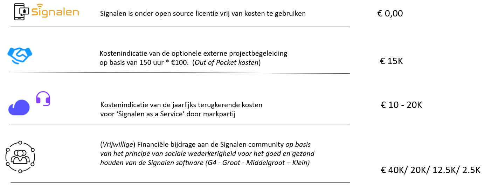

# Kostenindicaties

**Signalen software**

Signalen is beschikbaar onder een Open Source Licentie en kan zodoende vrij van kosten gebruikt worden. Iedereen kan Signalen 'downloaden' en onder de condities van de open source licentie gebruiken.

**Projectbegeleiding**

Het vertalen van je werkprocessen in Signalen, ook wel de technische inrichting van Signalen genoemd, kun je zelfstandig uitvoeren maar er zijn ook marktpartijen beschikbaar die hierbij kunnen ondersteunen. De ervaring leert dat deze ondersteuning ongeveer 150 uur aan inzet vraagt maar de mate van inzet is sterk afhankelijk van wat je zelf kan en wil doen.

**Signalen as a Service**

Signalen is onder de open source licentie vrij te gebruiken. Dat betekent ook dat je de software 'in huis' kunt hosten en beheren. We zien echter dat veel gemeenten deze expertise niet in huis hebben en daarom kiezen zij ervoor om 'Signalen as a Service' uit de markt af te nemen. De markt levert deze diensten inclusief; SLA, verwerkersovereenkomst en ISO27001 certificering voor het borgen van BIO/NIS2 en AVG.

**Communitybijdrage**

Om de Signalen samenwerking en de software goed en gezond te houden vragen we deelnemende gemeenten een financiële bijdrage te doen voor het afdekken van onze gemeenschappelijke kosten. Dit verzoek komt voort uit het principe van sociale wederkerigheid waarmee we een moreel appel doen op gemeenten om de Signalen-community financieel te steunen.

Daarnaast zijn er gemeenten die, naast de community bijdrage, ook inzet in natura leveren in de Regiegroep, Stuurgroep of communitymanagement. Gemeenten kunnen ook een bijdrage leveren aan de community door bepaalde functionaliteiten van de backlog te (laten) realiseren.

<figure><figcaption></figcaption></figure>

